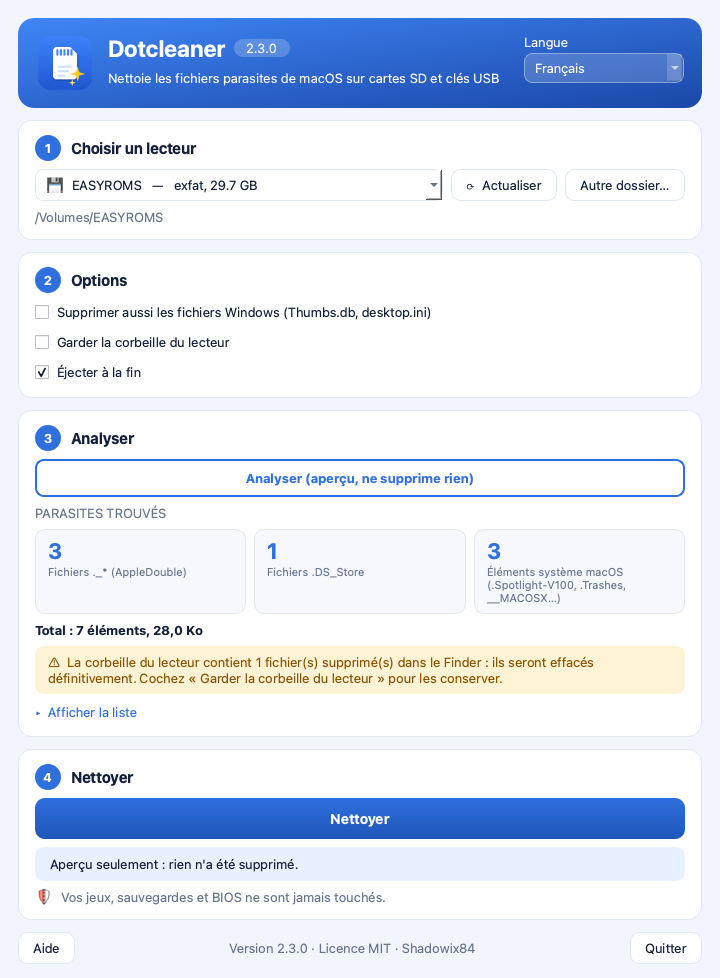
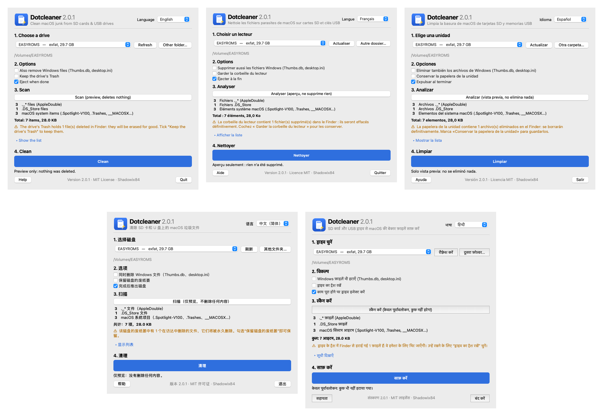
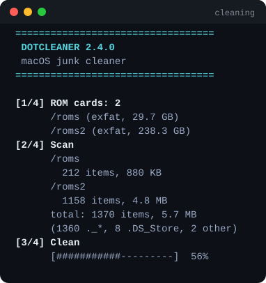
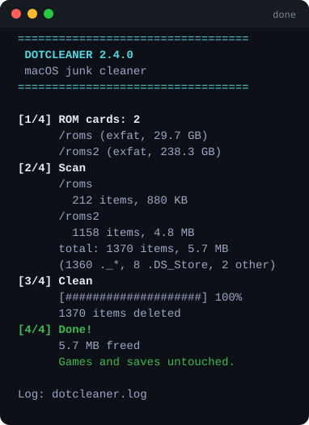
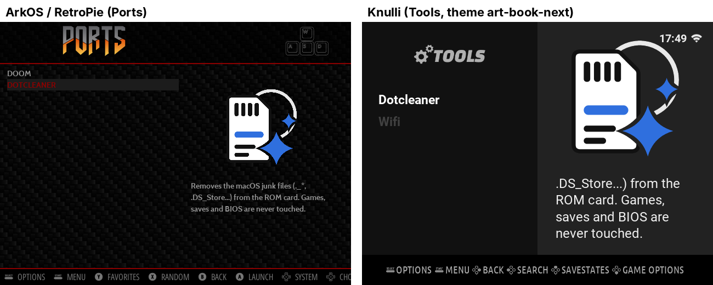
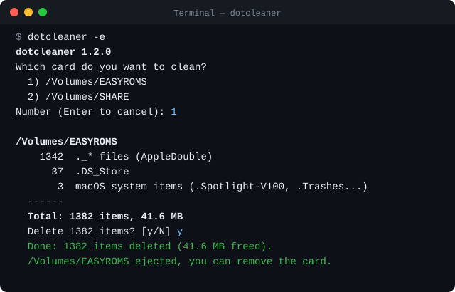

<div align="center">

# 🧹 Dotcleaner

**Supprime les fichiers cachés que macOS laisse sur les cartes SD et clés USB — pensé pour les consoles d'émulation.**<br>
Fini les jeux fantômes. Vos jeux, sauvegardes et BIOS ne sont jamais touchés.

[](https://github.com/Shadowix84/Dotcleaner-Multi-Software/releases/latest/download/Dotcleaner-macOS.dmg)
[](https://github.com/Shadowix84/Dotcleaner-Multi-Software/releases/latest/download/Dotcleaner-Windows.exe)
[](#️-lapplication-macos-windows-linux)
[](https://github.com/Shadowix84/Dotcleaner-Multi-Software/releases/latest/download/Dotcleaner-console.zip)

[](https://github.com/Shadowix84/Dotcleaner-Multi-Software/releases/latest)
[](https://github.com/Shadowix84/Dotcleaner-Multi-Software/releases)
[](https://github.com/Shadowix84/Dotcleaner-Multi-Software/actions/workflows/ci.yml)
[](LICENSE)

🌐 [Site web](https://shadowix84.github.io/Dotcleaner-Multi-Software/) · 🇬🇧 [English version](README.md)



</div>

**Sommaire** — [Pourquoi ?](#pourquoi-) · [Quelle version ?](#quelle-version-choisir-) · [Application](#️-lapplication-macos-windows-linux) ·
[Sur la console](#-sur-la-console-elle-même) · [Shell](#️-la-version-shell-terminal) ·
[Ce qui est supprimé](#ce-qui-est-supprimé) · [Compatibilité](#compatibilité) · [FAQ](#faq) ·
[À venir](#️-à-venir) · [Communauté](#communauté)

## Pourquoi ?

Quand un Mac copie des fichiers sur une carte SD, il ajoute des fichiers cachés à côté : un jumeau `._`
pour chaque fichier, un `.DS_Store` dans chaque dossier ouvert dans le Finder, et des dossiers comme
`.Spotlight-V100` ou `.Trashes`. Votre console affiche les jumeaux `._` comme des **jeux qui ne se lancent pas** :

```text
Avant                                   Après Dotcleaner
roms/gba/                               roms/gba/
├── ._Pokemon Emerald.gba   ← fantôme   └── Pokemon Emerald.gba
└── Pokemon Emerald.gba
```

Dotcleaner trouve ces fichiers et les supprime — **eux seulement**.

## Quelle version choisir ?

| Vous voulez… | Utilisez | Langues |
| --- | --- | --- |
| Nettoyer la carte **sur votre Mac ou PC** (le plus simple) | 🖥️ [L'application](#️-lapplication-macos-windows-linux) | English, Français, Español, 中文, हिन्दी |
| Nettoyer la carte **sur la console**, sans ordinateur | 🎮 [Le lanceur console](#-sur-la-console-elle-même) | anglais (écran simple) |
| Utiliser le **terminal** ou des scripts | ⌨️ [La version shell](#️-la-version-shell-terminal) | anglais |

Les trois utilisent les mêmes règles de nettoyage et les mêmes quatre étapes :
**1.** Choisir un lecteur · **2.** Options · **3.** Analyser (aperçu, ne supprime rien) · **4.** Nettoyer.

## 🖥️ L'application (macOS, Windows, Linux)

1. **Téléchargez** la version pour votre ordinateur :

   | Système | Fichier | Ensuite |
   | --- | --- | --- |
   | **macOS** 13+ (Intel et Apple Silicon) | [Dotcleaner-macOS.dmg](https://github.com/Shadowix84/Dotcleaner-Multi-Software/releases/latest/download/Dotcleaner-macOS.dmg) | Ouvrez-le, glissez **Dotcleaner** dans **Applications** |
   | **Windows** 10 / 11 | [Dotcleaner-Windows.exe](https://github.com/Shadowix84/Dotcleaner-Multi-Software/releases/latest/download/Dotcleaner-Windows.exe) | Double-cliquez dessus (rien à installer) |
   | **Linux** PC, Steam Deck | [Dotcleaner-Linux-x86_64](https://github.com/Shadowix84/Dotcleaner-Multi-Software/releases/latest/download/Dotcleaner-Linux-x86_64) | `chmod +x`, puis lancez-le |
   | **Linux** Raspberry Pi (64 bits) | [Dotcleaner-Linux-arm64](https://github.com/Shadowix84/Dotcleaner-Multi-Software/releases/latest/download/Dotcleaner-Linux-arm64) | `chmod +x`, puis lancez-le |

2. **Branchez** votre carte SD ou clé USB et ouvrez Dotcleaner.
3. **Choisissez** le lecteur → **Analysez** pour voir ce qui serait supprimé → **Nettoyez**.
   Avec **Éjecter à la fin** coché, vous pouvez retirer la carte tout de suite.

> [!NOTE]
> **Premier lancement.** L'application est gratuite et n'est pas signée avec un certificat Apple /
> Microsoft payant : votre ordinateur vous prévient une fois.
> - **macOS :** **Réglages Système → Confidentialité et sécurité**, faites défiler, cliquez sur **Ouvrir quand même**.
>   Autorisez ensuite l'accès aux *volumes amovibles* quand c'est demandé.
> - **Windows :** sur l'écran bleu *Windows a protégé votre ordinateur*, cliquez sur **Informations complémentaires → Exécuter quand même**.

Choisissez votre langue dans le menu en haut à droite :



## 🎮 Sur la console elle-même

Nettoyez la carte **sans ordinateur**, depuis le menu de la console — pas besoin de clavier.

1. Téléchargez [**Dotcleaner-console.zip**](https://github.com/Shadowix84/Dotcleaner-Multi-Software/releases/latest/download/Dotcleaner-console.zip) et décompressez-le. Dedans :
   `Dotcleaner.sh` (le lanceur), `icons/` (son icône pour le menu), `Onion/` (l'appli Onion) et un `README.txt`.
2. Copiez `Dotcleaner.sh` **et le dossier `icons`** sur la carte (créez le dossier s'il n'existe pas) :

   | Firmware (consoles) | Copier | Nom de la carte sur l'ordinateur |
   | --- | --- | --- |
   | **ArkOS**, dArkOS (R36S, RG351, RG353…) | `Dotcleaner.sh` + `icons/` → `ports/` | `EASYROMS` |
   | **Knulli** (RG40XXV, RG35XX…) | `Dotcleaner.sh` + `icons/` → `roms/tools/` | `SHARE` |
   | **Batocera** | `Dotcleaner.sh` + `icons/` → `roms/ports/` | `SHARE` |
   | **ROCKNIX**, AmberELEC, JELOS, EmuELEC | `Dotcleaner.sh` + `icons/` → `roms/ports/` | dépend de la carte |
   | **Onion** (Miyoo Mini) | le dossier `Onion/App/Dotcleaner` → `App/` | dépend de la carte |
   | muOS, MinUI, spruceOS, autres | `dotcleaner.sh` n'importe où, puis en SSH : `sh dotcleaner.sh --console` | dépend de la carte |

3. Sur la console, ouvrez **Ports → Dotcleaner** — **Tools → Dotcleaner** sur Knulli, **Apps →
   Dotcleaner** sur Onion. Sur Knulli / Batocera, mettez d'abord à jour les listes de jeux pour qu'il apparaisse.

Le lanceur trouve tout seul la carte des ROM — ou les deux cartes, ou chaque partition de jeux — et les nettoie sans rien demander.

**Ce qui s'affiche dépend du firmware :**

- **ArkOS et similaires** (dArkOS, ROCKNIX, AmberELEC, JELOS…) : un **écran texte très simple** montre
  chaque étape, puis la console revient au menu après 6 secondes.
- **Knulli : aucun écran** — c'est normal. Le nettoyage prend quelques secondes, puis vous revenez au
  menu. Le résultat est dans `dotcleaner.log`.
- **Onion :** une fenêtre de message à chaque étape.

<p align="center">
  
  
</p>

Partout, un fichier **`dotcleaner.log`** est écrit à côté du lanceur (sur Knulli : `roms/tools/` de la
carte `SHARE`) : il liste ce qui a été trouvé et supprimé — joignez-le à tout signalement de bug. Si des
jeux fantômes restent dans la liste ensuite, mettez à jour les listes de jeux.

**Son icône dans le menu.** Comme d'autres outils pour console (PlayTime sur Knulli…), le lanceur
s'ajoute tout seul au menu avec son icône (`gamelist.xml` à côté de lui) :

<p align="center"></p>

- **Knulli / Batocera :** automatique, dès le premier lancement (le menu enregistre lui-même l'icône).
- **ArkOS et autres :** si l'icône manque encore après un redémarrage, c'est que le menu a réécrit sa
  liste. Mettez la carte dans l'ordinateur, ouvrez `gamelist.xml` à côté de `Dotcleaner.sh` et ajoutez
  ces deux lignes dans le bloc `<game>` de Dotcleaner :

  ```xml
  <image>./icons/dotcleaner.png</image>
  <thumbnail>./icons/dotcleaner.png</thumbnail>
  ```

> [!TIP]
> **Deux cartes SD, ou une carte divisée en plusieurs partitions ?** Rien à régler : le lanceur trouve
> chaque carte et chaque partition qui contient un dossier `roms` et les nettoie toutes, l'une après
> l'autre — `/roms` et `/roms2` sur ArkOS, les deux cartes `SHARE` sur Knulli, `/mnt/mmc` et
> `/mnt/sdcard` sur muOS… Une partition sans jeux (système ou `BOOT`) n'est pas touchée, et une carte
> visible sous deux noms n'est nettoyée qu'une fois.

## ⌨️ La version shell (terminal)

Pour macOS, Linux, WSL et le SSH sur une console. Installez la commande `dotcleaner` — ouvrez le
**Terminal** et collez :

```sh
curl -fsSL https://raw.githubusercontent.com/Shadowix84/Dotcleaner-Multi-Software/main/install.sh | sh
```

Puis tapez `dotcleaner` pour ouvrir le menu (en anglais) :



Pas de Terminal ? Téléchargez [**Dotcleaner-shell.zip**](https://github.com/Shadowix84/Dotcleaner-Multi-Software/releases/latest/download/Dotcleaner-shell.zip), décompressez-le
et double-cliquez sur **`dotcleaner.command`** (macOS).

<details>
<summary><b>Options en ligne de commande</b> (pour les scripts)</summary>

Donnez un ou plusieurs chemins au lieu d'utiliser le menu :

```sh
dotcleaner -n /Volumes/EASYROMS      # aperçu : affiche ce qui serait supprimé
dotcleaner -y -e /Volumes/EASYROMS   # nettoie puis éjecte, sans question
dotcleaner -w "/Volumes/NO NAME"     # supprime aussi les fichiers Windows
```

| Option | Effet |
| --- | --- |
| `-n`, `--dry-run` | Aperçu : affiche ce qui serait supprimé, ne supprime rien |
| `-y`, `--yes` | Ne demande pas de confirmation |
| `-w`, `--windows` | Supprime aussi `Thumbs.db`, `ehthumbs.db`, `desktop.ini` |
| `-k`, `--keep-trash` | Ne touche pas à la corbeille du lecteur (`.Trashes`) |
| `-e`, `--eject` | Éjecte le lecteur à la fin (macOS) |
| `-v`, `--verbose` | Liste chaque élément supprimé |
| `-q`, `--quiet` | N'affiche que les erreurs |
| `--console` | Mode console : trouve la ou les cartes des ROM et les nettoie avec l'écran simple |
| `-h`, `--help` / `-V`, `--version` | Aide / version |

Codes de sortie : `0` OK · `1` erreur sur au moins un lecteur · `2` mauvaise utilisation · `130` interrompu.
</details>

## Ce qui est supprimé

| Élément | Ce que c'est |
| --- | --- |
| `._*` | Métadonnées macOS enregistrées à côté de chaque fichier copié — les **jeux fantômes** |
| `.DS_Store` | Réglages d'affichage des dossiers du Finder |
| `.Spotlight-V100` | Index de recherche Spotlight du lecteur |
| `.Trashes` | La corbeille du lecteur (fichiers supprimés dans le Finder) |
| `.fseventsd` | Journal des événements du système de fichiers |
| `.TemporaryItems`, `.DocumentRevisions-V100` | Fichiers temporaires et versions de documents |
| `.apdisk`, `.AppleDouble`, `.AppleDB`, `.AppleDesktop` | Métadonnées de disque et de partage réseau |
| `__MACOSX` | Restes des fichiers zip créés sur un Mac |
| `Thumbs.db`, `ehthumbs.db`, `desktop.ini` | Fichiers Windows — **seulement si l'option Windows est cochée** |

**Jamais touchés :** ROM, sauvegardes, BIOS, photos, documents et tous les autres fichiers, cachés ou non.

- 🔗 Les liens ne sont jamais suivis et les autres lecteurs jamais parcourus ; les dossiers système et personnels sont refusés.
- 🛡️ **Mode sûr sur les disques au format Mac** (APFS, HFS+) : là, les dossiers macOS contiennent de
  vraies données, donc seuls `._*`, `.DS_Store`, `.apdisk` et `__MACOSX` sont supprimés. Les cartes
  de console (FAT32, exFAT) sont nettoyées entièrement.
- 🔬 Chaque modification est vérifiée par un audit automatique : des milliers de cartes de test sont
  comparées fichier par fichier avant et après le nettoyage, avec chaque version. Une seule mauvaise
  suppression et la publication est bloquée.

## Compatibilité

| Système | Application | Shell / lanceur |
| --- | --- | --- |
| macOS 13+ (Intel et Apple Silicon) | ✅ | ✅ |
| macOS 12 ou plus ancien | — | ✅ |
| Windows 10 / 11 | ✅ | ✅ dans WSL |
| Linux x86_64 — Steam Deck, Ubuntu 22.04+, Debian 12+, Fedora… | ✅ | ✅ |
| Linux ARM64 — Raspberry Pi OS 13+, Ubuntu 24.04+… | ✅ | ✅ |
| **Consoles** — ArkOS, dArkOS, Knulli, Batocera, ROCKNIX, AmberELEC, JELOS, EmuELEC, Onion, muOS, MinUI, Allium, spruceOS, TrimUI, RetroPie | — | ✅ |

Si l'application Linux ne démarre pas, installez `libxcb-cursor0`. La version shell est en `sh` POSIX
pur : elle fonctionne avec bash, dash, BusyBox, ksh, mksh, posh, yash et zsh.

## FAQ

<details>
<summary><b>Peut-il supprimer mes jeux ou mes sauvegardes ?</b></summary>

Non. Il ne supprime que les noms exacts listés dans [Ce qui est supprimé](#ce-qui-est-supprimé). Un
fichier comme `Jeu._beta.gba` ou une sauvegarde cachée comme `.jeu.srm` est conservé. Utilisez
d'abord **Analyser** : la liste complète s'affiche et rien n'est supprimé.
</details>

<details>
<summary><b>Les fichiers <code>._</code> sont revenus. Pourquoi ?</b></summary>

macOS les recrée à chaque copie de fichiers sur la carte. Nettoyez après chaque copie — sur la
console, ça ne prend que quelques secondes.
</details>

<details>
<summary><b>Et la corbeille du lecteur ?</b></summary>

Les fichiers supprimés dans le Finder sur le lecteur vont dans son dossier caché `.Trashes` et prennent
encore de la place. Dotcleaner vous prévient avant de les effacer. Cochez **Garder la corbeille du
lecteur** (`-k`) pour les conserver.
</details>

<details>
<summary><b>Rien ne se passe quand je le lance sur ma console.</b></summary>

1. Utilisez le **lanceur** `Dotcleaner.sh` (D majuscule, dans `Dotcleaner-console.zip`), pas
   `dotcleaner.sh` : le script simple attend un clavier.
2. Vérifiez qu'il est dans le bon dossier (`ports`, `tools` sur Knulli, `App/` sur Onion) et, sur
   Knulli / Batocera, mettez à jour les listes de jeux.
3. **Sur Knulli, rien ne s'affiche à l'écran** : c'est normal, le nettoyage ne prend que quelques secondes.
4. Ouvrez **`dotcleaner.log`** à côté : il indique ce qui a été trouvé et nettoyé. Toujours bloqué ?
   Ouvrez un [signalement de bug](https://github.com/Shadowix84/Dotcleaner-Multi-Software/issues/new?template=bug_report.yml) avec ce fichier.
</details>

<details>
<summary><b>Ma console a deux cartes SD.</b></summary>

Depuis la 2.4.0, le lanceur nettoie **les deux cartes** d'un coup — et chaque partition qui contient un
dossier `roms` quand une carte est divisée en plusieurs. L'écran liste chaque carte trouvée, puis une
seule barre de progression pour toutes. En SSH, `dotcleaner.sh` sans option affiche les mêmes cartes
dans son menu.
</details>

## 🗺️ À venir

- [x] **Version console pour deux cartes SD** et pour les cartes divisées en plusieurs partitions — faite dans la 2.4.0.
- Une idée ? [Proposez-la](https://github.com/Shadowix84/Dotcleaner-Multi-Software/issues/new?template=feature_request.yml).

Ce qui a changé à chaque version : [CHANGELOG](CHANGELOG.md) (en anglais).

## Communauté

- 💬 Une question ? Ouvrez un ticket sur GitHub, en français ou en anglais.
- 🐞 [Signaler un bug](https://github.com/Shadowix84/Dotcleaner-Multi-Software/issues/new?template=bug_report.yml) ·
  💡 [Proposer une idée](https://github.com/Shadowix84/Dotcleaner-Multi-Software/issues/new?template=feature_request.yml) ·
  🌍 [Améliorer une traduction](https://github.com/Shadowix84/Dotcleaner-Multi-Software/issues/new?template=translation.yml)
  — en français ou en anglais.
- 🛠️ Envie d'aider sur le code ou de lancer les tests ? Voir [CONTRIBUTING.md](CONTRIBUTING.md) (en anglais).
- 🔒 Un fichier supprimé alors qu'il n'aurait pas dû ? Voir [SECURITY.md](SECURITY.md).
- ⭐ Si Dotcleaner a sauvé votre carte, une étoile aide d'autres joueurs à le trouver !

## Licence

[MIT](LICENSE) — © 2026 Shadowix84
