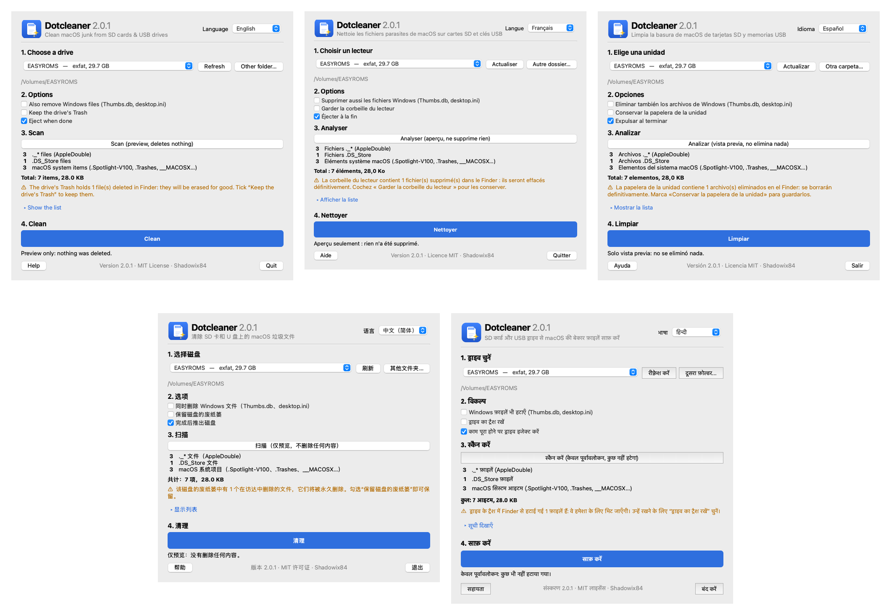
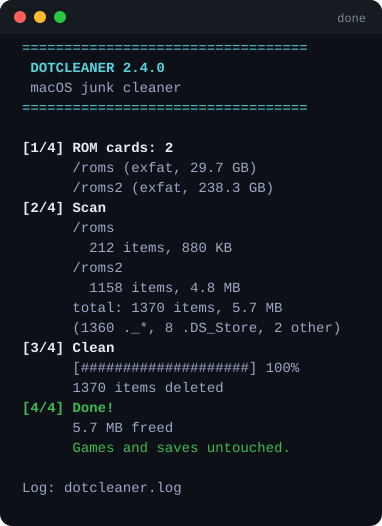
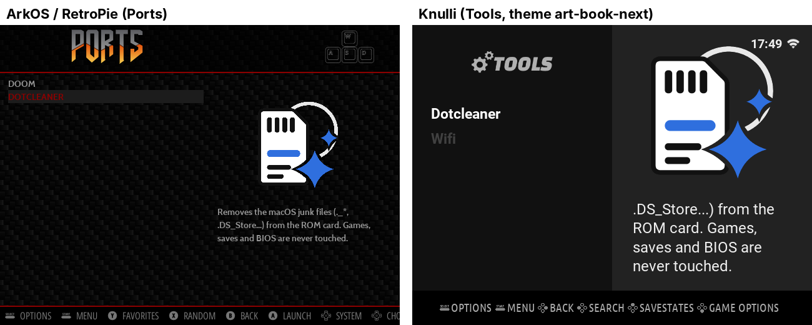

<div align="center">

# 🧹 Dotcleaner

**Remove the hidden junk files macOS leaves on SD cards and USB drives — made for emulation handhelds.**<br>
No more ghost games. Your games, saves and BIOS are never touched.

[](https://github.com/Shadowix84/Dotcleaner-Multi-Software/releases/latest/download/Dotcleaner-macOS.dmg)
[](https://github.com/Shadowix84/Dotcleaner-Multi-Software/releases/latest/download/Dotcleaner-Windows.exe)
[](#️-the-app-macos-windows-linux)
[](https://github.com/Shadowix84/Dotcleaner-Multi-Software/releases/latest/download/Dotcleaner-console.zip)

[](https://github.com/Shadowix84/Dotcleaner-Multi-Software/releases/latest)
[](https://github.com/Shadowix84/Dotcleaner-Multi-Software/releases)
[](https://github.com/Shadowix84/Dotcleaner-Multi-Software/actions/workflows/ci.yml)
[](LICENSE)

🌐 [Website](https://shadowix84.github.io/Dotcleaner-Multi-Software/) · 🇫🇷 [Version française](README.fr.md)


</div>

**Contents** — [Why?](#why) · [Which version?](#which-version-do-i-need) · [App](#️-the-app-macos-windows-linux) ·
[On the console](#-on-the-console-itself) · [Shell](#️-the-shell-version-terminal) ·
[What it removes](#what-it-removes) · [Compatibility](#compatibility) · [FAQ](#faq) ·
[Roadmap](#️-roadmap) · [Community](#community)

## Why?

When a Mac copies files to an SD card, it adds hidden files next to them: a `._` twin for every file,
a `.DS_Store` in every folder opened in Finder, and folders like `.Spotlight-V100` or `.Trashes`.
Your console lists the `._` twins as **games that won't launch**:

```text
Before                                  After Dotcleaner
roms/gba/                               roms/gba/
├── ._Pokemon Emerald.gba   ← ghost     └── Pokemon Emerald.gba
└── Pokemon Emerald.gba
```

Dotcleaner finds these files and removes them — **only them**.

## Which version do I need?

| You want to… | Use | Languages |
| --- | --- | --- |
| Clean the card **on your Mac or PC** (easiest) | 🖥️ [The app](#️-the-app-macos-windows-linux) | English, Français, Español, 中文, हिन्दी |
| Clean the card **on the console**, without a computer | 🎮 [The console launcher](#-on-the-console-itself) | English (simple screen) |
| Use the **terminal** or scripts | ⌨️ [The shell version](#️-the-shell-version-terminal) | English |

All three use the same cleaning rules and the same four steps:
**1.** Choose a drive · **2.** Options · **3.** Scan (preview, deletes nothing) · **4.** Clean.

## 🖥️ The app (macOS, Windows, Linux)

1. **Download** the version for your computer:

   | System | File | Then |
   | --- | --- | --- |
   | **macOS** 13+ (Intel & Apple Silicon) | [Dotcleaner-macOS.dmg](https://github.com/Shadowix84/Dotcleaner-Multi-Software/releases/latest/download/Dotcleaner-macOS.dmg) | Open it, drag **Dotcleaner** to **Applications** |
   | **Windows** 10 / 11 | [Dotcleaner-Windows.exe](https://github.com/Shadowix84/Dotcleaner-Multi-Software/releases/latest/download/Dotcleaner-Windows.exe) | Double-click it (nothing to install) |
   | **Linux** PC, Steam Deck | [Dotcleaner-Linux-x86_64](https://github.com/Shadowix84/Dotcleaner-Multi-Software/releases/latest/download/Dotcleaner-Linux-x86_64) | `chmod +x` it, then run it |
   | **Linux** Raspberry Pi (64-bit) | [Dotcleaner-Linux-arm64](https://github.com/Shadowix84/Dotcleaner-Multi-Software/releases/latest/download/Dotcleaner-Linux-arm64) | `chmod +x` it, then run it |

2. **Plug in** your SD card or USB drive and open Dotcleaner.
3. **Choose** the drive → **Scan** to see what would be deleted → **Clean**.
   With **Eject when done** ticked, you can unplug the card right away.

> [!NOTE]
> **First launch.** The app is free and not signed with a paid Apple / Microsoft certificate, so your
> computer warns you once:
> - **macOS:** **System Settings → Privacy & Security**, scroll down, click **Open Anyway**.
>   Then allow access to *removable volumes* when asked.
> - **Windows:** on the blue *Windows protected your PC* screen, click **More info → Run anyway**.

Choose your language in the top-right menu:



## 🎮 On the console itself

Clean the card **without a computer**, from the console's menu — no keyboard needed.

1. Download [**Dotcleaner-console.zip**](https://github.com/Shadowix84/Dotcleaner-Multi-Software/releases/latest/download/Dotcleaner-console.zip) and unzip it. Inside: `Dotcleaner.sh`
   (the launcher), `icons/` (its icon for the menu), `Onion/` (the Onion app) and a `README.txt`.
2. Copy `Dotcleaner.sh` **and the `icons` folder** to the card (create the folder if it does not exist):

   | Firmware (consoles) | Copy | Card name on a computer |
   | --- | --- | --- |
   | **ArkOS**, dArkOS (R36S, RG351, RG353…) | `Dotcleaner.sh` + `icons/` → `ports/` | `EASYROMS` |
   | **Knulli** (RG40XXV, RG35XX…) | `Dotcleaner.sh` + `icons/` → `roms/tools/` | `SHARE` |
   | **Batocera** | `Dotcleaner.sh` + `icons/` → `roms/ports/` | `SHARE` |
   | **ROCKNIX**, AmberELEC, JELOS, EmuELEC | `Dotcleaner.sh` + `icons/` → `roms/ports/` | depends on the card |
   | **Onion** (Miyoo Mini) | the `Onion/App/Dotcleaner` folder → `App/` | depends on the card |
   | muOS, MinUI, spruceOS, others | `dotcleaner.sh` anywhere, then over SSH: `sh dotcleaner.sh --console` | depends on the card |

3. On the console, open **Ports → Dotcleaner** — **Tools → Dotcleaner** on Knulli, **Apps → Dotcleaner**
   on Onion. On Knulli / Batocera, update the game lists first so it appears.

The launcher finds the ROM card by itself — or both cards, or every games partition — and cleans them without asking.

**What you see depends on the firmware:**

- **ArkOS and similar** (dArkOS, ROCKNIX, AmberELEC, JELOS…): a **very simple text screen** shows each
  step, then the console goes back to the menu after 6 seconds.
- **Knulli: no screen** — that is normal. The cleaning takes a few seconds, then you are back in the
  menu. Check the result in `dotcleaner.log`.
- **Onion:** a message box at each step.

<p align="center">
  
  
</p>

Everywhere, a **`dotcleaner.log`** file is written next to the launcher (on Knulli: `roms/tools/` on
the `SHARE` card): it lists what was found and deleted — send it with any bug report. If ghost games
are still listed afterwards, update the game lists.

**Its icon in the menu.** Like other console tools (PlayTime on Knulli…), the launcher adds itself to
the menu with its icon (`gamelist.xml` next to it):

<p align="center"></p>

- **Knulli / Batocera:** automatic, the first time you start it (the menu itself saves the icon).
- **ArkOS and others:** if the icon is still missing after a restart, the menu rewrote its list. Put the
  card in your computer, open `gamelist.xml` next to `Dotcleaner.sh` and add these two lines inside the
  Dotcleaner `<game>` block:

  ```xml
  <image>./icons/dotcleaner.png</image>
  <thumbnail>./icons/dotcleaner.png</thumbnail>
  ```

> [!TIP]
> **Two SD cards, or one card split in several partitions?** Nothing to set up: the launcher finds
> every card and partition that holds a `roms` folder and cleans them all, one after the other —
> `/roms` and `/roms2` on ArkOS, both `SHARE` cards on Knulli, `/mnt/mmc` and `/mnt/sdcard` on muOS…
> A partition without games (the system or `BOOT` partition) is left alone, and a card seen under two
> names is cleaned once.

## ⌨️ The shell version (terminal)

For macOS, Linux, WSL and SSH on a console. Install the `dotcleaner` command — open **Terminal** and paste:

```sh
curl -fsSL https://raw.githubusercontent.com/Shadowix84/Dotcleaner-Multi-Software/main/install.sh | sh
```

Then type `dotcleaner` to open the menu:


No Terminal? Download [**Dotcleaner-shell.zip**](https://github.com/Shadowix84/Dotcleaner-Multi-Software/releases/latest/download/Dotcleaner-shell.zip), unzip it
and double-click **`dotcleaner.command`** (macOS).

<details>
<summary><b>Command-line options</b> (for scripts)</summary>

Give one or more paths instead of using the menu:

```sh
dotcleaner -n /Volumes/EASYROMS      # preview: show what would be deleted
dotcleaner -y -e /Volumes/EASYROMS   # clean then eject, no questions
dotcleaner -w "/Volumes/NO NAME"     # also remove Windows files
```

| Option | Effect |
| --- | --- |
| `-n`, `--dry-run` | Preview: show what would be deleted, delete nothing |
| `-y`, `--yes` | Do not ask for confirmation |
| `-w`, `--windows` | Also remove `Thumbs.db`, `ehthumbs.db`, `desktop.ini` |
| `-k`, `--keep-trash` | Leave the drive's Trash (`.Trashes`) untouched |
| `-e`, `--eject` | Eject the drive when done (macOS) |
| `-v`, `--verbose` | List every deleted item |
| `-q`, `--quiet` | Only print errors |
| `--console` | Console mode: find the ROM card(s) and clean them with the simple screen |
| `-h`, `--help` / `-V`, `--version` | Help / version |

Exit codes: `0` OK · `1` error on at least one drive · `2` wrong usage · `130` interrupted.
</details>

## What it removes

| Item | What it is |
| --- | --- |
| `._*` | macOS metadata saved next to every copied file — the **ghost games** |
| `.DS_Store` | Finder folder view settings |
| `.Spotlight-V100` | Spotlight search index of the drive |
| `.Trashes` | The drive's Trash (files deleted in Finder) |
| `.fseventsd` | File system event log |
| `.TemporaryItems`, `.DocumentRevisions-V100` | Temporary files and document versions |
| `.apdisk`, `.AppleDouble`, `.AppleDB`, `.AppleDesktop` | Disk and network share metadata |
| `__MACOSX` | Leftovers from zip files made on a Mac |
| `Thumbs.db`, `ehthumbs.db`, `desktop.ini` | Windows files — **only if you tick the Windows option** |

**Never touched:** ROMs, saves, BIOS, photos, documents and every other file, hidden or not.

- 🔗 Links are never followed and other drives are never entered; system and home folders are refused.
- 🛡️ **Safe mode on Mac-formatted drives** (APFS, HFS+): there, the macOS folders hold real data, so
  only `._*`, `.DS_Store`, `.apdisk` and `__MACOSX` are removed. Console cards (FAT32, exFAT) are cleaned completely.
- 🔬 Every change is checked by an automatic audit: thousands of test cards are compared file by file
  before and after cleaning, with every version. One wrong deletion and the release is blocked.

## Compatibility

| System | App | Shell / launcher |
| --- | --- | --- |
| macOS 13+ (Intel & Apple Silicon) | ✅ | ✅ |
| macOS 12 or older | — | ✅ |
| Windows 10 / 11 | ✅ | ✅ in WSL |
| Linux x86_64 — Steam Deck, Ubuntu 22.04+, Debian 12+, Fedora… | ✅ | ✅ |
| Linux ARM64 — Raspberry Pi OS 13+, Ubuntu 24.04+… | ✅ | ✅ |
| **Consoles** — ArkOS, dArkOS, Knulli, Batocera, ROCKNIX, AmberELEC, JELOS, EmuELEC, Onion, muOS, MinUI, Allium, spruceOS, TrimUI, RetroPie | — | ✅ |

If the Linux app does not start, install `libxcb-cursor0`. The shell version is plain POSIX `sh`: it
runs with bash, dash, BusyBox, ksh, mksh, posh, yash and zsh.

## FAQ

<details>
<summary><b>Can it delete my games or saves?</b></summary>

No. It only deletes the exact names listed in [What it removes](#what-it-removes). A file like
`Game._beta.gba` or a hidden save like `.game.srm` is kept. Use **Scan** first: it shows the full list
and deletes nothing.
</details>

<details>
<summary><b>The <code>._</code> files came back. Why?</b></summary>

macOS creates them again every time it copies files to the card. Clean after each copy — on the
console it only takes a few seconds.
</details>

<details>
<summary><b>What about the drive's Trash?</b></summary>

Files deleted in Finder on the drive go to its hidden `.Trashes` folder and still take space.
Dotcleaner warns you before erasing them. Tick **Keep the drive's Trash** (`-k`) to keep them.
</details>

<details>
<summary><b>Nothing happens when I start it on my console.</b></summary>

1. Use the **launcher** `Dotcleaner.sh` (capital D, from `Dotcleaner-console.zip`), not `dotcleaner.sh`:
   the plain script waits for a keyboard.
2. Check that it is in the right folder (`ports`, `tools` on Knulli, `App/` on Onion), and on Knulli /
   Batocera update the game lists.
3. **On Knulli nothing appears on screen**: that is normal, the cleaning only takes a few seconds.
4. Open **`dotcleaner.log`** next to it: it says what was found and cleaned. Still stuck? Open a
   [bug report](https://github.com/Shadowix84/Dotcleaner-Multi-Software/issues/new?template=bug_report.yml) with this file.
</details>

<details>
<summary><b>My console has two SD cards.</b></summary>

Since 2.4.0 the launcher cleans **both cards** in one go — and every partition holding a `roms`
folder when one card is split in several. The screen lists each card it found, then a single progress
bar for all of them. Over SSH, `dotcleaner.sh` without options shows the same cards in its menu.
</details>

## 🗺️ Roadmap

- [x] **Console version for two SD cards** and for cards split in several partitions — done in 2.4.0.
- Ideas? [Suggest one](https://github.com/Shadowix84/Dotcleaner-Multi-Software/issues/new?template=feature_request.yml).

What changed in each version: [CHANGELOG](CHANGELOG.md).

## Community

- 💬 Questions? Open an issue on GitHub, in English or in French.
- 🐞 [Report a bug](https://github.com/Shadowix84/Dotcleaner-Multi-Software/issues/new?template=bug_report.yml) ·
  💡 [Suggest an idea](https://github.com/Shadowix84/Dotcleaner-Multi-Software/issues/new?template=feature_request.yml) ·
  🌍 [Improve a translation](https://github.com/Shadowix84/Dotcleaner-Multi-Software/issues/new?template=translation.yml)
- 🛠️ Want to help with the code or run the tests? See [CONTRIBUTING.md](CONTRIBUTING.md).
- 🔒 A file deleted that should not have been? See [SECURITY.md](SECURITY.md).
- ⭐ If Dotcleaner saved your card, a star helps other players find it!

## License

[MIT](LICENSE) — © 2026 Shadowix84
